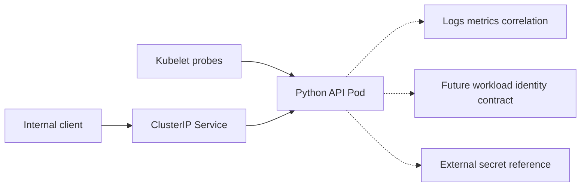

# Cloud-Native Platform Engineering Reference

A local-only reference project for packaging a small Python API and expressing secure Kubernetes workload-delivery contracts with Kustomize.

It is a reference project, not a production deployment.

## What it demonstrates

- A Python HTTP API with pod-targeted liveness, readiness, metadata, metrics, and correlation-ID handling.
- A non-root container image with an explicit work directory and no runtime package installation.
- Kubernetes Deployment, ClusterIP Service, ServiceAccount, ConfigMap, NetworkPolicy, and HPA resources.
- DEV and PROD Kustomize overlays with distinct namespaces, replica/HPA ranges, and image-governance expectations.
- Pod security contexts, resource requests/limits, rolling-update settings, and startup/liveness/readiness probes.
- Structured logs and minimal Prometheus-compatible metrics with no sensitive request logging.
- Static and local container validation only. No cluster, cloud identity, registry publication, or GitHub Actions workflow.

## Architecture



See [architecture](docs/architecture.md), [security and identity](docs/security-and-identity.md), [observability](docs/observability.md), [local validation](docs/local-validation.md), [deployment runbook](docs/deployment-runbook.md), and [rollback runbook](docs/rollback-runbook.md).

## Tooling baseline

The V1 local baseline is verified with:

| Tool | Version |
|---|---:|
| Python | 3.12.11 |
| Docker CLI and Engine | 28.5.1 |
| kubectl | 1.34.1 |
| Integrated Kustomize | 5.7.1 |
| pytest | 8.4.2 |
| PyYAML | 6.0.3 |

## Local setup and validation

```bash
python3.12 -m venv .venv
.venv/bin/pip install -e '.[dev]'

PYTHON_COMMAND=.venv/bin/python ./scripts/validate-local.sh
docker build --tag cloud-native-reference:local .
docker run --rm --read-only --user 10001:10001 -p 18080:8080 cloud-native-reference:local
```

The validation script runs pytest and renders both Kustomize overlays through `kubectl kustomize`. It does not use `kubectl apply`, query a Kubernetes cluster, authenticate to a cloud account, or publish an image.

## API contract

| Endpoint | Purpose |
|---|---|
| `GET /live` | Process liveness for a kubelet startup/liveness probe |
| `GET /ready` | Application readiness for a kubelet readiness probe |
| `GET /api/v1/info` | Safe service name and version metadata |
| `GET /metrics` | Minimal Prometheus-compatible request counter |

Kubelet probes are directed to the Pod’s named `http` port. They do not traverse the Kubernetes Service.

## Security and configuration boundaries

- The Service is `ClusterIP`; no Ingress, `NodePort`, or `LoadBalancer` resource exists.
- The API uses a dedicated ServiceAccount and defaults token automounting to `false`.
- The repository contains no Secret resource, secret value, token, cloud credential, tenant ID, or client ID.
- The Deployment contains only an optional external Secret reference. A real secret source is outside V1.
- The NetworkPolicy selects the API Pods, allows ingress only from approved labeled Pods in the same namespace on TCP 8080, and allows egress only to a kube-system DNS selector on TCP/UDP 53.
- NetworkPolicy enforcement depends on the target cluster CNI and is not verified locally.

## Environment contracts

| Contract | DEV | PROD |
|---|---|---|
| Namespace | `platform-dev` | `platform-prod` |
| Deployment replicas | 1 | 3 |
| HPA range | 1–2 | 3–6 |
| Image contract | Explicit non-`latest` development tag | Immutable-digest placeholder to replace through approved delivery governance |
| Pod Security labels | Restricted reference labels | Restricted reference labels |

The Deployment replica count matches the HPA minimum in each overlay. HPA operation still requires cluster metrics support and is not proven by local rendering.

## Limitations

- No Kubernetes cluster was provisioned or contacted.
- No image registry, cloud identity, external secret system, autoscaler, NetworkPolicy engine, or observability backend was used.
- Kustomize rendering and manifest tests are not a Kubernetes admission, scheduling, CNI enforcement, or production-certification result.
- Workload identity is a documentation contract only; no provider-specific identity binding is present.
- No GitHub Actions workflow is included.

## License

MIT License. See [LICENSE](LICENSE).
