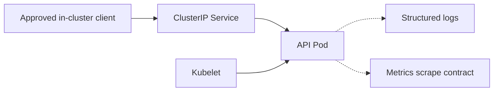

# Architecture and workload boundaries

## Workload path

The kubelet calls the Pod IP and named container port directly for startup, liveness, and readiness checks. It does not use the Service. The Service is only an internal stable endpoint for approved workload clients.

## Resource ownership

| Resource | Responsibility |
|---|---|
| Deployment | Pod lifecycle, security context, resources, probes, and rolling-update strategy |
| Service | Internal ClusterIP routing to API Pods |
| ServiceAccount | Workload identity boundary; no token automount by default |
| ConfigMap | Non-sensitive service configuration |
| NetworkPolicy | Manifest-level ingress/egress intent for API Pods |
| HPA | CPU target and environment-specific min/max capacity contract |
| Kustomize overlays | Namespace and environment differences only |

## Environment isolation

The base is environment-neutral. Overlays place rendered resources into `platform-dev` or `platform-prod`; they do not share namespaces, HPA ranges, or image-governance expectations. The platform fixture uses a development tag only in DEV and a digest-shaped placeholder only in PROD. Neither is pushed or deployed by this project.
